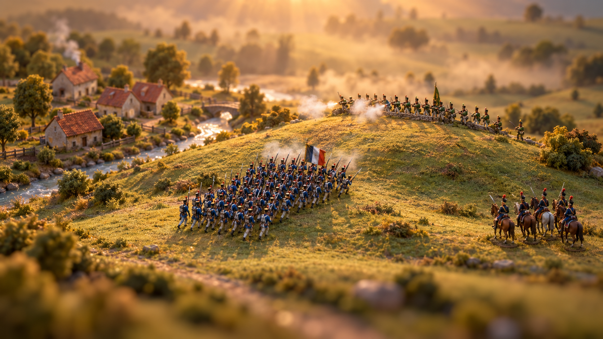

# RTS

A browser real-time strategy game about Napoleonic battles, rendered as a living storybook
illustration: real 3D, but every frame looks painted. The same renderer will produce cinematic
history videos.

## Status

Prototyping the look. Open `prototypes/painted-cinematic.html` in Chrome; no build step.

| Prototype | What it shows |
|---|---|
| `painted-cinematic.html` | **Current.** Baked light map, painted water, valley mist, light shafts, golden backlight, cinematic grade, seasons, optional depth of field |
| `staff-map.html` | **Feel prototype** of the far-zoom staff map and the zoom into the world |
| `painted-hybrid.html` | Real sun shadows + SSAO under painterly shading (superseded) |
| `painted-foliage.html` | Leaf-card trees from a stylized `.blend` pack (superseded) |
| `painted-nature.html` | First painterly pass on the Quaternius pack (superseded) |
| `painted-diorama.html` | The retired tin-soldier diorama direction |

## Docs

- [`design.md`](design.md): art bible
- [`web-rts-architecture.md`](web-rts-architecture.md): game architecture
- [`prototype-plan.md`](prototype-plan.md): prototype phases and the current workstream
- [`asset-sources.md`](asset-sources.md): asset sources and licences
- [`staff-map/`](staff-map/design.md): the far-zoom staff map
- [`research/`](research/): post-processing and water research

## Assets

Raw packs are not in git. To regenerate the model data:

- **Quaternius Ultimate Nature** (CC0): extract to `assets/nature-pack/` (with its `OBJ/` folder),
  then `node tools/obj-to-js.mjs`.
- **Stylized foliage `.blend` files** (`Trees.blend`, `FilesPlants.blend`): place in
  `assets/painted-foliage/`, then run `tools/blend-to-js.py` with Blender (see its header).

The generated `prototypes/*.data.js` files are committed, so the prototypes run without the packs.

## Credits

- Nature models: [Quaternius](https://quaternius.com) (CC0).
- Elevation data (later): AWS Terrain Tiles.
- Engine: [Babylon.js](https://www.babylonjs.com) 9.
